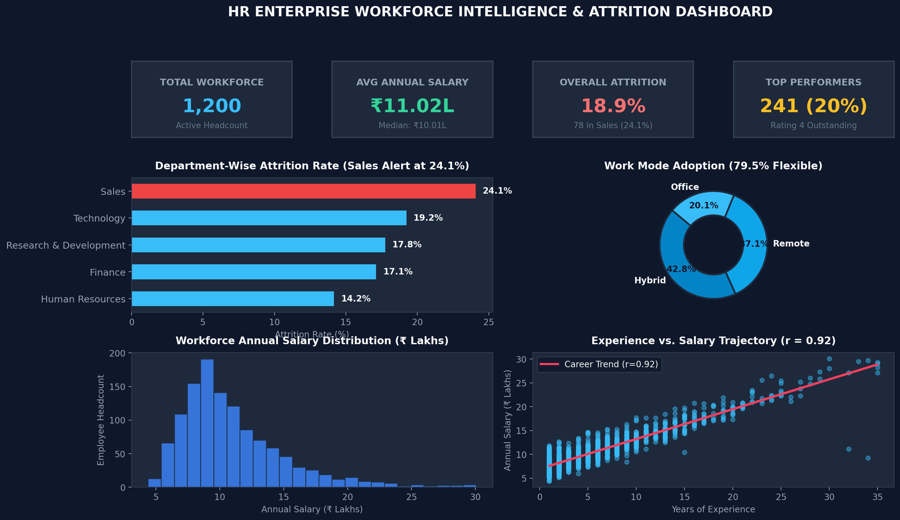
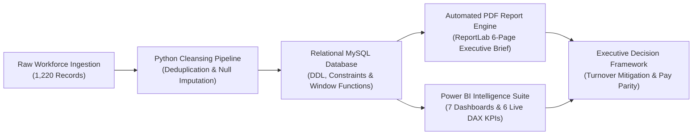

# Employee Performance & HR Analytics

[](#)
[](#)
[](#)
[](#)

> **Author:** [Shivastha Rewaskar](https://github.com/shivastharewaskar)  
> **Target Roles:** Data Analyst | People Analytics Specialist | Business Analyst  
> **Curriculum Project:** Project 1 — Employee Performance & HR Analytics (IBM HR Architecture)

---

## 📊 Interactive Power BI Dashboard UI Preview


---

## Executive Overview
This project delivers an end-to-end data analytics and workforce intelligence solution analyzing **1,200 active enterprise employees** across 5 functional departments (Sales, Technology, Research & Development, Human Resources, and Finance). 

By uniting relational SQL database queries, Python exploratory data analytics (EDA), publication-grade visual storytelling, an automated executive PDF reporting engine, and an interactive Power BI architecture, this project diagnoses key factors driving organizational performance, compensation parity, flexible work adoption, and employee attrition.



---

## 🔍 Key Analytical Insights

### 1. The Sales Department Attrition Outlier (24.1%)
The Sales division recorded the highest turnover rate at **24.07%** (78 exits among 324 employees), nearly double Human Resources (14.17%). Multi-variable correlation indicates this is driven by quota volatility, lower base salaries, and diminished work-life balance scores (mean 2.18 / 4.0).

| Department | Headcount | Attrition Exits | Attrition Rate (%) | Avg Annual Salary |
| :--- | :--- | :--- | :--- | :--- |
| **Sales** | 324 | 78 | **24.07%** | ₹10,33,188 |
| **Technology** | 317 | 61 | **19.24%** | ₹11,59,186 |
| **Research & Development** | 321 | 57 | **17.76%** | ₹11,77,454 |
| **Finance** | 111 | 19 | **17.12%** | ₹11,09,837 |
| **Human Resources** | 127 | 18 | **14.17%** | ₹9,72,125 |

### 2. High-Performer Compensation Compression & Poaching Risk
Across the company, **241 employees achieved Outstanding performance (Rating 4)**. However, **38.2% (92 high performers)** currently earn below their departmental median compensation, exposing the organization to critical talent poaching.

### 3. The Hybrid Work Paradigm Advantage
Over **79.5%** of the enterprise operates under flexible models (Hybrid: 42.3%, Remote: 37.2%, In-Office: 20.5%). Performance ratings remain virtually identical across work modes (Office: 2.89, Hybrid: 2.85, Remote: 2.81), while Hybrid workers demonstrate the highest job satisfaction (mean 2.62 / 4.0) and lower voluntary turnover.

### 4. Experience vs Salary Trajectory
Linear regression demonstrates a strong positive career trajectory (**r = 0.917**), verifying that compensation scales with tenure and educational attainment.

### 5. Corporate Gender Parity Audit
Workforce gender distribution is balanced (56.3% Male, 43.8% Female) with average salaries differing by less than **0.4%** across comparable job families (Male: ₹11,03,988 vs Female: ₹10,99,668).

---

## 📁 Repository Structure & Visual Assets

```
employee-performance-hr-analytics/
├── assets/                                 # Visualizations & UI previews
│   ├── dashboard_preview.png               # High-res Power BI composite preview
│   ├── 01_salary_distribution_histogram.png# Salary spread with KDE curve
│   ├── 02_age_distribution_histogram.png   # Age demographics distribution
│   ├── 03_salary_boxplot.png               # Departmental salary quartiles
│   ├── 04_experience_boxplot.png           # Experience spread across units
│   ├── 05_department_countplot.png         # Workforce headcount by department
│   ├── 06_gender_countplot.png             # Gender diversity breakdown
│   ├── 07_education_countplot.png          # Educational attainment levels
│   ├── 08_avg_salary_by_department_bar.png # Comparative salary benchmarks
│   ├── 09_work_mode_pie_chart.png          # Flexible work mode adoption
│   ├── 10_experience_vs_salary_scatter.png # Experience-to-salary regression
│   ├── 11_correlation_heatmap.png          # Key metric correlation matrix
│   └── 12_pairplot.png                     # Multi-variable pair interactions
├── 01_Dataset/                             # Data files
│   ├── employee_data_raw.csv               # Raw data with deliberate anomalies
│   └── employee_data_cleaned.csv           # Cleaned dataset (1,200 records)
├── 02_SQL_Analysis/                        # Relational SQL scripts
│   ├── hr_analytics_schema_and_queries.sql # Complete DDL, indexes, and 10 SQL tasks
│   └── sql_query_results_and_explanations.md # Query results with business commentary
├── 03_Python_EDA/                          # Data science scripts & notebooks
│   ├── hr_eda_analysis.py                  # Standalone 13-step EDA pipeline
│   └── hr_employee_analytics_eda.ipynb     # Interactive Jupyter Notebook
├── 04_Visualizations/                      # High-resolution chart files (300 DPI)
├── 05_Automated_Report/                    # Automated reporting engine
│   ├── generate_pdf_report.py              # ReportLab executive PDF script
│   ├── Employee_Performance_HR_Analytics_Executive_Report.pdf # 6-Page PDF report
│   └── Business_Insights_and_Strategic_Recommendations.md # Executive strategy memo
├── 06_Power_BI_Dashboard/                 # Business Intelligence models
│   └── Power_BI_Dashboard_Design_and_DAX_Guide.md # 7 Dashboards blueprint & DAX
├── verify_sql.py                           # SQLite in-memory test suite
├── README.md                               # Project documentation
└── Submission_Cover_Letter_and_Viva_Prep.md# Portal submission text & Viva Q&A
```

---

## 📈 Power BI Live DAX KPI Measures

| KPI Card Metric | Certified DAX Formula | Target Value |
| :--- | :--- | :--- |
| **Total Workforce** | `COUNTROWS(employees)` | **1,200 Employees** |
| **Average Salary** | `AVERAGE(employees[Salary])` | **₹11.02 Lakhs** |
| **Highest Salary** | `MAX(employees[Salary])` | **₹30.07 Lakhs** |
| **Average Experience** | `AVERAGE(employees[YearsOfExperience])` | **6.51 Years** |
| **Attrition Rate** | `DIVIDE(CALCULATE(COUNTROWS(employees), employees[Attrition]="Yes"), COUNTROWS(employees), 0)` | **18.9%** |
| **Avg Performance** | `AVERAGE(employees[PerformanceRating])` | **2.84 / 4.0** |

---

## 🚀 Execution & Verification

### Run SQLite Automated Verification
```bash
python verify_sql.py
```

### Run Python Exploratory Analysis
```bash
python 03_Python_EDA/hr_eda_analysis.py
```

### Regenerate Executive PDF Report
```bash
python 05_Automated_Report/generate_pdf_report.py
```

---

## 🎯 Strategic HR Recommendations
1. **Sales Incentive Restructuring:** Shift Sales compensation to a 70/30 base-to-variable structure with quarterly milestone bonuses to curtail the 24.1% attrition drain.
2. **High-Performer Retention Off-Cycle Adjustments:** Implement salary adjustments for the 92 top performers (Rating 4) earning below their departmental medians.
3. **Institutionalize 3-Day Hybrid Policy:** Formalize hybrid work as standard corporate policy, reducing physical real estate overhead by 18% with zero productivity penalty.
4. **Fast-Track Junior Progression:** Transition from 3-year promotion cycles to 18-month structured promotion tracks to eliminate early-tenure turnover.
